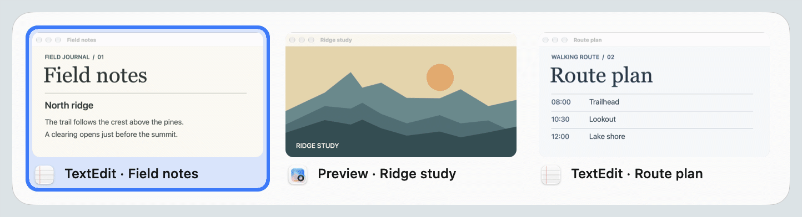

# Macdows

Macdows is a free macOS menu-bar utility from Astonio Ltd. Cycle through windows using the physical key above Tab in any keyboard layout, or use ⌘Tab to switch between windows on the current desktop. Each feature has its own setting.

[Download for Mac](https://astonio.com/lab/macdows/Macdows.dmg) · [Website](https://astonio.com/lab/macdows/index.html) · [Release notes](https://github.com/katlianik/macdows/releases) · [Release feed](https://github.com/katlianik/macdows/releases.atom) · [Report a problem](https://github.com/katlianik/macdows/issues)

## Get started

1. On an Intel or Apple silicon Mac running macOS 11 or later, open the DMG and drag Macdows into Applications. Quit any running copy before updating.
2. Open Macdows from Applications. Click its menu-bar icon and choose **Settings…**. In **General**, open Accessibility Settings and grant Macdows access to keyboard and window controls.
3. To limit ⌘Tab to your current desktop, open **Switcher** and choose **Macdows · This desktop**. Under **Display**, choose app icons or previews. For previews, allow Screen Recording in the same pane. The default **macOS · All apps** uses the system switcher.

Move the pointer onto a card or use Tab to select it. While the Macdows switcher is open, ⌘W or ⌃W closes the selected window. ⌘Q or ⌃Q quits the selected app, or closes Finder’s windows when Finder is selected.

macOS may ask for Automation access to Finder when opening a Finder window, and to System Events when switching desktops. Enable only the features you use.

**Windows** controls window cycling, desktop switching, window buttons, dragging and tiling. **Keyboard** controls Globe/Fn and keyboard layout shortcuts. **Apps & Finder** controls what happens when an app becomes active and enables cut-and-move in Finder. Window tiling shortcuts require macOS 15 or later. [All features and shortcuts](https://astonio.com/lab/macdows/index.html#features) · [Website changelog](https://astonio.com/lab/macdows/index.html#updates)

For a bug report, include your macOS version, Macdows build, relevant settings, and the shortest steps that reproduce the issue.



⌘Tab with one preview per window, shown with sample documents.

## Install with Homebrew

If you use Homebrew, add the project’s tap and install the cask:

```sh
brew tap katlianik/macdows https://github.com/katlianik/macdows
brew trust --cask katlianik/macdows/macdows
brew install --cask katlianik/macdows/macdows
```

For later releases, run `brew update` and `brew upgrade --cask katlianik/macdows/macdows`.

## Remove Macdows

1. Choose **Settings…** from the Macdows menu. In **General**, turn off **Launch at login** if enabled. On macOS 15 or later, open **Windows** and turn off **Tile left or right**, **Arrange, fill or restore** and **Fill or restore with the green button**. Macdows restores the App Shortcuts it managed. Reopen affected apps to reload their shortcuts.
2. Choose **Quit Macdows** from the menu bar to restore the previous Globe/Fn mapping. If the icon is hidden, open Macdows from Applications to bring it back.
3. Move Macdows from Applications to the Trash. For Homebrew installations, run `brew uninstall --cask katlianik/macdows/macdows`.
4. To remove saved preferences, run `defaults delete local.redquit.utility` after quitting. You can revoke Macdows permissions in macOS Privacy settings under Accessibility, Automation and Screen Recording.

## Requirements

- macOS with Xcode 27 or later
- Apple clang
- macOS 11 deployment target or later

## Build and test

Compile the AppleScript resources first:

```sh
export DEVELOPER_DIR=/Applications/Xcode.app/Contents/Developer
mkdir -p Macdows.app/Contents/MacOS
osacompile -o Macdows.app/Contents/Resources/OpenEmptyFinder.scpt Macdows.app/Contents/Resources/OpenEmptyFinder.applescript
osacompile -o Macdows.app/Contents/Resources/SwitchDesktopLeft.scpt Macdows.app/Contents/Resources/SwitchDesktopLeft.applescript
osacompile -o Macdows.app/Contents/Resources/SwitchDesktopRight.scpt Macdows.app/Contents/Resources/SwitchDesktopRight.applescript
```

Compile a universal executable:

```sh
xcrun clang -fobjc-arc -fblocks -mmacosx-version-min=11.0 -arch arm64 -arch x86_64 \
  Macdows.app/Contents/Resources/Macdows.m -o Macdows.app/Contents/MacOS/Macdows \
  -framework Cocoa -framework ServiceManagement -framework IOKit \
  -framework Carbon -framework ApplicationServices
```

Run the regression tests:

```sh
xcrun clang -fobjc-arc -fblocks -mmacosx-version-min=11.0 test.m -o test \
  -framework Cocoa -framework ServiceManagement -framework IOKit \
  -framework Carbon -framework ApplicationServices
./test
```

Signing and notarization are intentionally not part of the source archive.
